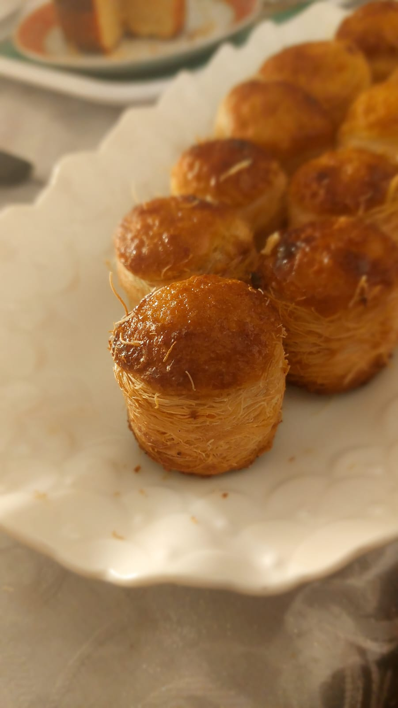

# Kunafa à la crème d’amandes

| Catégorie | Difficulté | Cuisson |
|---|---|---|
| Pâtisserie | Facile | Au four, jusqu’à ce que la crème soit ferme |

Des nids de kunafa croustillants, garnis d’une crème d’amandes, cuits en petits moules individuels.

## Ingrédients

**Kunafa**

- Pâte kunafa (cheveux d’ange)

**Crème d’amandes**

- 80 g de beurre mou
- 80 g de sucre
- 2,75 œufs (environ 140 g battus)
- 133 g de poudre d’amande
- Extrait d’amande amère (facultatif)

## Préparation

1. Mélanger la poudre d’amande avec les œufs.
2. Ajouter le sucre et le beurre mou.
3. Ajouter l’extrait d’amande amère si vous en mettez.
4. Mélanger jusqu’à obtenir une crème lisse.
5. Garnir la kunafa avec la crème d’amandes.
6. Cuire au four jusqu’à ce que la crème devienne ferme.

## À compléter

- Quantité de pâte kunafa et nombre de pièces
- Température et temps de cuisson
